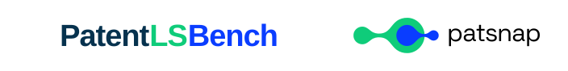

<p align="center">
  
</p>

<h1 align="center">PatentLSBench</h1>

[English](README.md) | **简体中文**

**基于专利证据的生命科学模型与 Agent 评测基准**

PatentLSBench 以专利证据为基础，评测大语言模型与 AI Agent 的生命科学专业任务能力。

[GitHub](https://github.com/patsnap/PatentLSBench/blob/main/README.zh.md) | [🤗 Chemical NER](https://huggingface.co/datasets/PatSnap/chemical-ner-bench/blob/main/README.zh.md) | [🤗 Chemical OCSR](https://huggingface.co/datasets/PatSnap/chemical-ocsr-bench/blob/main/README.zh.md)

## 评测任务

| 任务 | 输入 | 交付 | 发布与资源 |
| --- | --- | --- | --- |
| [Chemical NER](chemical-ner/README.zh.md) | 专利权利要求或说明书文本 | 化学实体及关联分子结构 | 已发布 · [测试数据](chemical-ner/data/test.jsonl) |
| [Chemical OCSR](chemical-ocsr/README.zh.md) | 化学结构图像或单页 PDF | 分子结构；PDF 模式另含化学结构区域框 | 已发布 · [测试数据](chemical-ocsr/data/test.jsonl) |
| [LCA](lca/) | 专利号或药物代号 | 候选分子、相关专利与支持证据 | 计划于 2026 年 12 月底开源 |
| [SAR](sar/) | 小分子专利材料 | 关联分子结构、实验上下文与来源位置的活性记录 | 计划于 2026 年 12 月底开源 |
| [LS Research](ls-research/) | 研究问题 | 完整回答或报告及来源引用 | 计划于 2026 年 12 月底开源 |

## 数据集

Chemical NER 与 Chemical OCSR 在 GitHub 和 Hugging Face 均提供数据，核心记录、参考答案与源附件一致；Hugging Face 另提供 Parquet 视图，各数据集使用独立仓库维护。

- **Chemical NER V1.0**： 11 个专利公开号、22 条完整权利要求或说明书输入、6,334 处实体参考提及，涵盖中文、英文、日文和韩文。
- **Chemical OCSR V1.0**： 50 个单页栅格 PDF、536 个已标注化学区域、277 个 MOL 参考，以及 272 对 SMILES/InChIKey 参考。

当前 OCSR 的分子识别评测仅覆盖具有适用参考标识符的完整化学结构；Layout 评测同时覆盖非完整结构。

## 评价

各任务README说明输入、输出与评价口径。报告明确被评系统、数据集与参考版本、匹配或评分量规标准、评价单位、覆盖范围与局限。同类模型或Agent组内比较采用一致的任务材料、证据范围、信息截止时点、可用工具与执行预算。各任务分项报告成绩，PatentLSBench不合成跨任务总分。

## 发布计划

| 计划时间 | 发布内容 |
| --- | --- |
| 2026 年 12 月底 | 开源 LCA、SAR 与 LS Research 数据集 |
| 2026 年 12 月底 | 公布技术报告或论文 |
| 2026 年 12 月底 | 上线片段与 Markush 主核的 OCSR 识别评测 |
| 2026 年 12 月底 | 上线 OCSR 人工审核的分类标签 |
| 2027 年 3 月底 | 上线更完整的 Markush 结构识别评测，包含 R 基团具体定义、链接路径及约束关系 |

## 能力扩展

PatentLSBench 将持续扩展化学信息联合交付、序列与修饰档案、大分子序列—活性证据整理、竞争格局与资产对标，并逐步纳入 Agent 执行行为评价。

## 引用

```bibtex
@misc{patsnap_patentlsbench_2026,
  title  = {PatentLSBench},
  author = {PatSnap},
  year   = {2026},
  url    = {https://github.com/patsnap/PatentLSBench}
}
```

## 许可证与免责声明

代码和项目文档采用 [MIT 许可证](LICENSE)。数据集、标注及配套附件采用 [CC BY-NC 4.0](LICENSE.data)，第三方材料仍受其适用权利和单独条款约束。

PatentLSBench 材料及相关输出可能存在错误或遗漏，不构成法律、专利、医疗或监管意见，也不构成专业认证。使用者在依赖这些材料前须进行审查与验证，确保具备处理材料所需的权利，并遵守适用的许可证及访问条款；详见[完整免责声明](DISCLAIMER.zh.md)。

Copyright (c) 2026 PatSnap.
