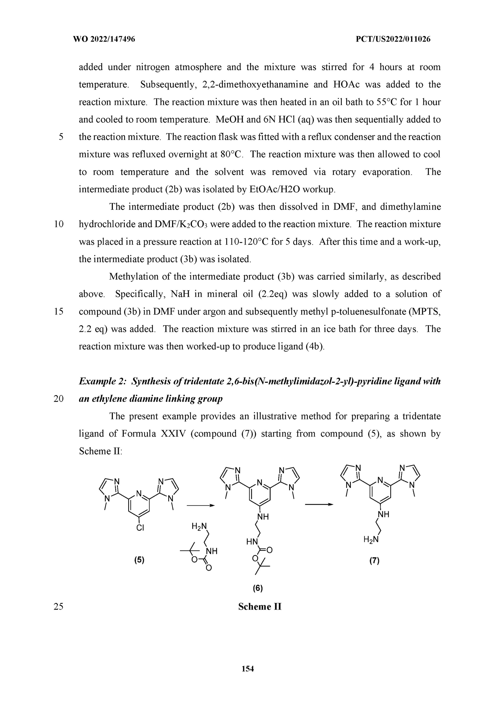
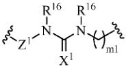
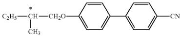

# Chemical OCSR

[PatentLSBench](https://github.com/patsnap/PatentLSBench) · **English** | [简体中文](README.zh.md) · [Evaluation Protocol](../docs/evaluation-protocol.md)

Chemical OCSR evaluates molecular recognition from chemical structure images, and chemical-region detection and recognition from single-page patent PDFs. The Patent Page Chemical Structure Detection and Recognition Benchmark provides exhaustively annotated pages, expert-reviewed region labels and complete-structure molecular references.

[🤗 Dataset](https://huggingface.co/datasets/PatSnap/chemical-ocsr-bench) · [Data files](https://huggingface.co/datasets/PatSnap/chemical-ocsr-bench/tree/main/public-50-pages) · [Data schema](https://huggingface.co/datasets/PatSnap/chemical-ocsr-bench/blob/main/public-50-pages/schema.json)

## Dataset

**v1.0.0** contains 50 complete pages from 50 patent publication numbers. It preserves every annotated chemical region and its associated references on each supplied page.

| Resource | Count |
| --- | ---: |
| Original single-page PDFs | 50 |
| Chemical regions and annotated crops | 536 |
| Original MOL references | 277 |
| Valid canonical-SMILES references | 272 |
| Valid standard-InChIKey references | 272 |
| Label dimensions | 9 |

## Examples

Page preview (the page task uses its original PDF) and original annotated region crops.



 

## Input and references

| Mode | Model input | References |
| --- | --- | --- |
| Image | An annotated chemical-region crop | Complete molecular structures on the fixed valid-InChIKey list |
| PDF | An original single-page patent PDF | All chemical-region bounding boxes; complete-structure molecular references |

PDFs are the page task's model input; page images provide previews. The image task uses the supplied original annotation crops. Keep image recognition and PDF results separate.

Layout references include complete structures, substituents, Markush structures and other non-complete chemical expressions. Molecular recognition uses the 272 complete-structure references with valid InChIKeys. All 277 original MOL files are retained; MOL availability and identifier scoring populations are recorded separately.

Boxes use normalized `[x1, y1, x2, y2]` coordinates with a top-left origin. `coordinate_reference_size` records the original annotation raster size. Normalize predictions against the model's aligned page rendering and preserve the page geometry.

## Evaluation

| Layer | Matching criteria | Metrics |
| --- | --- | --- |
| Layout · PDF | One-to-one bounding-box matching; this edition uses IoU ≥ 0.5 | Precision, recall, F1 |
| OCSR · image and PDF | Full standard-InChIKey equality on the fixed Key-reference population | Precision, recall, F1 |
| Joint page recovery · supplementary | Correct molecular identity under the fixed Layout assignment | Recovered targets / fixed molecular targets |

Report Layout and molecular recognition separately, including actual target populations and micro-aggregated counts. Repeated occurrences retain their multiplicity. Preserve components, charge, isotopes, explicit hydrogens and specified stereochemistry when deriving identifiers.

Canonical-SMILES exact match is a supplementary metric evaluated on its own fixed target list. The complete rules, format-specific masks and molecular normalization settings are in [the edition's evaluation protocol](https://huggingface.co/datasets/PatSnap/chemical-ocsr-bench/blob/main/public-50-pages/EVALUATION.md) and [molecular reference protocol](https://huggingface.co/datasets/PatSnap/chemical-ocsr-bench/blob/main/public-50-pages/MOLECULAR_GT_PROTOCOL.md).

## Labels

| Field | Dimension | Examples |
| --- | --- | --- |
| `type` | Structure type | Complete structure, substituent, Markush structure |
| `chemical_family` | Chemical family | Organic, peptide, nucleic-acid, coordination/organometallic |
| `component_features` | Component form | Salt/ion pair, hydrate, solvate |
| `atom_bond_features` | Atom and bond features | Isotope, charge, coordination bond |
| `stereo_features` | Stereochemical notation | Wedge bonds, double-bond geometry, axial chirality |
| `notation_features` | Abbreviations and generalized notation | Fixed abbreviation, variable group, repeat notation |
| `topology_features` | Ring topology | Macrocycle, fused, spiro, bridged |
| `scene` | Page context | Reaction scheme, structure table, grouped structures |
| `image_defects` | Image quality | Blur, broken bonds, text interference |

The original Chinese label values remain unchanged in the data. The dictionary contains 68 values; observed feature coverage counts `(dimension, label)` pairs. Regions can carry multiple features. See the [schema](https://huggingface.co/datasets/PatSnap/chemical-ocsr-bench/blob/main/public-50-pages/schema.json) and [statistics](https://huggingface.co/datasets/PatSnap/chemical-ocsr-bench/blob/main/public-50-pages/statistics.json) for definitions and counts.

## Access

Hugging Face provides three configurations, each under the `test` split:

| Configuration | Rows | Contents |
| --- | ---: | --- |
| `pages` · default | 50 | Page records, nested Layout/OCSR references and page-image previews |
| `regions` | 536 | Region records, labels and crop previews |
| `molecules` | 277 | MOL-reference records and nullable standard identifiers |

```python
from datasets import load_dataset

pages = load_dataset("PatSnap/chemical-ocsr-bench", "pages", split="test")
regions = load_dataset("PatSnap/chemical-ocsr-bench", "regions", split="test")
print(pages[0]["id"], regions[0]["region_image"].size)
```

Download the original PDFs, crops and MOL files together with their manifests:

```python
from pathlib import Path
from huggingface_hub import snapshot_download

snapshot = snapshot_download(
    repo_id="PatSnap/chemical-ocsr-bench",
    repo_type="dataset",
    allow_patterns="public-50-pages/**",
)
root = Path(snapshot) / "public-50-pages"
pdf = root / pages[0]["pdf_path"]
```

The edition root contains `pages.jsonl`, `regions.jsonl`, `ocsr.jsonl`, `schema.json`, `evaluation_masks.json`, `statistics.json`, normalization resources and the original `assets/`. JSONL paths are relative to this root. The Parquet views retain source fields and add embedded `page_image` or `region_image` previews.

Run the standard-library reader against an extracted edition:

```bash
python chemical-ocsr/examples/inspect_dataset.py /path/to/public-50-pages --verify
```

## Citation and license

```bibtex
@misc{patsnap_patent_page_ocsr_2026,
  title   = {Patent Page Chemical Structure Detection and Recognition Benchmark},
  author  = {PatSnap},
  year    = {2026},
  version = {1.0.0},
  url     = {https://huggingface.co/datasets/PatSnap/chemical-ocsr-bench}
}
```

The public dataset and annotations use [CC BY-NC 4.0](https://huggingface.co/datasets/PatSnap/chemical-ocsr-bench/blob/main/public-50-pages/LICENSE.txt). Code and project documentation use the [MIT License](../LICENSE). Third-party source materials retain their applicable rights and terms; normalization resources include their own notices.
