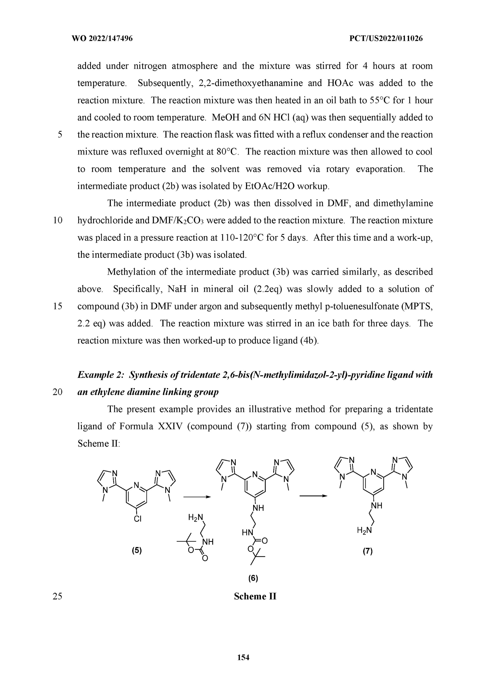
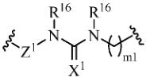
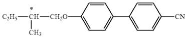

# Chemical OCSR

[PatentLSBench](https://github.com/patsnap/PatentLSBench/blob/main/README.zh.md) · [English](README.md) | **简体中文** · [评价协议](../docs/evaluation-protocol.zh.md)

Chemical OCSR 评价化学结构图像中的分子识别能力，以及单页专利 PDF 中化学结构区域的定位与识别能力。数据集提供区域标注框、标签、裁图及完整结构分子参考。

[数据与附件](data/README.zh.md) · [字段规范](data/schema.json) · [评测协议](data/EVALUATION.zh.md) · [🤗 数据集](https://huggingface.co/datasets/PatSnap/chemical-ocsr-bench/blob/main/README.zh.md)

## 数据集

**v1.0.0** 包含来自 50 个专利公开号的 50 个单页栅格 PDF 输入。所提供的 PDF 不含嵌入式文本层，各页面记录关联相应区域标注与分子参考。

| 资源 | 数量 |
| --- | ---: |
| 单页栅格 PDF | 50 |
| 化学区域及标注裁图 | 536 |
| MOL 参考文件 | 277 |
| 有效规范 SMILES 参考 | 272 |
| 有效标准 InChIKey 参考 | 272 |
| 标签维度 | 9 |

## 示例

页面预览与所提供的化学区域裁图；页级任务使用包内 PDF 输入。



 

## 输入与参考

| 模式 | 模型输入 | 参考答案 |
| --- | --- | --- |
| 图像 | 标注化学区域裁图 | 固定有效 InChIKey 名单内的完整分子结构 |
| PDF | 包内单页栅格 PDF | 所提供的化学区域边界框与完整结构分子参考 |

包内 PDF 是页级任务的模型输入，页面图像用于预览。图像任务使用所提供的标注裁图，图像识别与 PDF 结果分别报告。

Layout 参考覆盖完整结构、取代基、马库什结构及其他非完整化学表达。分子识别基于 272 条具有有效 InChIKey 的完整结构参考计分。277 个 MOL 参考与标识符计分范围分别记录。

边界框采用左上角原点的归一化 `[x1, y1, x2, y2]` 坐标。`coordinate_reference_size` 记录原标注栅格尺寸；预测框按模型自身对齐后的页面渲染尺寸归一化，并保持页面几何一致。

## 评价

| 层级 | 匹配依据 | 指标 |
| --- | --- | --- |
| Layout · PDF | 边界框一对一匹配；本版采用 IoU ≥ 0.5 | Precision、Recall、F1 |
| OCSR · 图像与 PDF | 固定 Key 参考范围内的完整标准 InChIKey 一致 | Precision、Recall、F1 |
| 整页联合恢复 · 补充 | 固定 Layout 匹配下分子身份正确 | 恢复目标数 / 固定分子目标数 |

Layout 定位与分子识别分别报告，注明各自实际目标范围及微汇总计数。相同结构在不同位置的重复出现保留其次数。生成标识符时保留组分、电荷、同位素、显式氢及已指定立体信息。

规范 SMILES 精确匹配作为补充指标，使用对应的固定评测名单。完整匹配规则、格式名单和分子规范化设置见[评测协议](data/EVALUATION.zh.md)与[分子参考协议](data/MOLECULAR_GT_PROTOCOL.zh.md)。

仅将提供的 PDF 或裁图字节送入参评模型，参考框、结构答案和标注标签保留在评价侧。

## 标签

| 字段 | 维度 | 示例 |
| --- | --- | --- |
| `type` | 结构类型 | 完整结构、取代基、马库什结构 |
| `chemical_family` | 化学家族 | 有机、肽、核酸、配位/有机金属结构 |
| `component_features` | 组分形式 | 盐/离子对、水合物、溶剂化物 |
| `atom_bond_features` | 原子与键特征 | 同位素、电荷、配位键 |
| `stereo_features` | 立体表达 | 楔线、双键几何、轴手性 |
| `notation_features` | 缩写与泛化表达 | 固定缩写、变量基团、重复表达 |
| `topology_features` | 环拓扑 | 大环、稠环、螺环、桥环 |
| `scene` | 所在版式场景 | 反应图、结构表格、多结构图组 |
| `image_defects` | 图像质量 | 模糊、断线、文字干扰 |

数据保留原始中文标签值。词表含 68 个值，实际覆盖按“维度 + 标签”计数；同一区域可含多个特征。定义与分布见[字段规范](data/schema.json)和[统计文件](data/statistics.json)。

## 数据读取

GitHub 的 `chemical-ocsr/data/` 与 Hugging Face 的 `public-50-pages/` 提供相同的核心 JSONL 记录、参考文件和 PDF/图像/MOL 附件。Hugging Face 另提供内嵌图像的 Parquet 视图。

### 本地文件

在仓库根目录使用 Python 标准库读取并校验数据：

```bash
python chemical-ocsr/examples/inspect_dataset.py chemical-ocsr/data --verify
```

| 路径 | 内容 |
| --- | --- |
| `data/pages.jsonl` | 页面记录与嵌套区域、分子参考 |
| `data/regions.jsonl` | 区域记录、边界框及标签 |
| `data/ocsr.jsonl` | 通过页面和区域 ID 关联的分子参考 |
| `data/assets/` | 包内 PDF、页预览、区域裁图与 MOL |
| `data/schema.json`、`data/evaluation_masks.json` | 字段规范与固定参考名单 |
| `data/EVALUATION.zh.md`、`data/MOLECULAR_GT_PROTOCOL.zh.md` | 评价与分子参考协议 |

完整文件说明见[数据 README](data/README.zh.md)。附件路径相对 `data/`；`regions.page_id` 关联 `pages.id`，`ocsr.region_id` 关联 `regions.id`，`ocsr.page_id` 同样关联 `pages.id`。

### Hugging Face

各配置均提供 `test` split：

| 配置 | 行数 | 内容 |
| --- | ---: | --- |
| `pages` · 默认 | 50 | 页面记录、嵌套参考与内嵌 `page_image` 预览 |
| `regions` | 536 | 区域记录、标签与内嵌 `region_image` 裁图 |
| `molecules` | 277 | MOL 参考记录与可空标准标识符 |

使用具有仓库访问权限的 HF 账号登录：

```bash
hf auth login
```

```python
from datasets import load_dataset

pages = load_dataset("PatSnap/chemical-ocsr-bench", "pages", split="test", revision="v1.0.0", token=True)
regions = load_dataset("PatSnap/chemical-ocsr-bench", "regions", split="test", revision="v1.0.0", token=True)
molecules = load_dataset("PatSnap/chemical-ocsr-bench", "molecules", split="test", revision="v1.0.0", token=True)
print(pages[0]["id"], regions[0]["region_image"].size)
```

下载 PDF 输入与参考附件：

```python
import json
from pathlib import Path
from huggingface_hub import snapshot_download

snapshot = snapshot_download(
    repo_id="PatSnap/chemical-ocsr-bench",
    repo_type="dataset",
    revision="v1.0.0",
    token=True,
    allow_patterns="public-50-pages/**",
)
edition = Path(snapshot) / "public-50-pages"
with (edition / "pages.jsonl").open(encoding="utf-8") as stream:
    page = json.loads(next(stream))
pdf_bytes = (edition / page["pdf_path"]).read_bytes()
```

模型输入仅使用 PDF 字节或区域图像；参考表单独用于评价。

## 引用与许可证

```bibtex
@misc{patsnap_patent_page_ocsr_2026,
  title   = {Patent Page Chemical Structure Detection and Recognition Benchmark},
  author  = {PatSnap},
  year    = {2026},
  version = {1.0.0},
  url     = {https://huggingface.co/datasets/PatSnap/chemical-ocsr-bench}
}
```

公开数据与标注采用 [CC BY-NC 4.0](data/LICENSE.txt)，代码与项目文档采用 [MIT 许可证](../LICENSE)。第三方来源材料保留其适用权利与条款，规范化资源附有各自的来源及许可声明。
